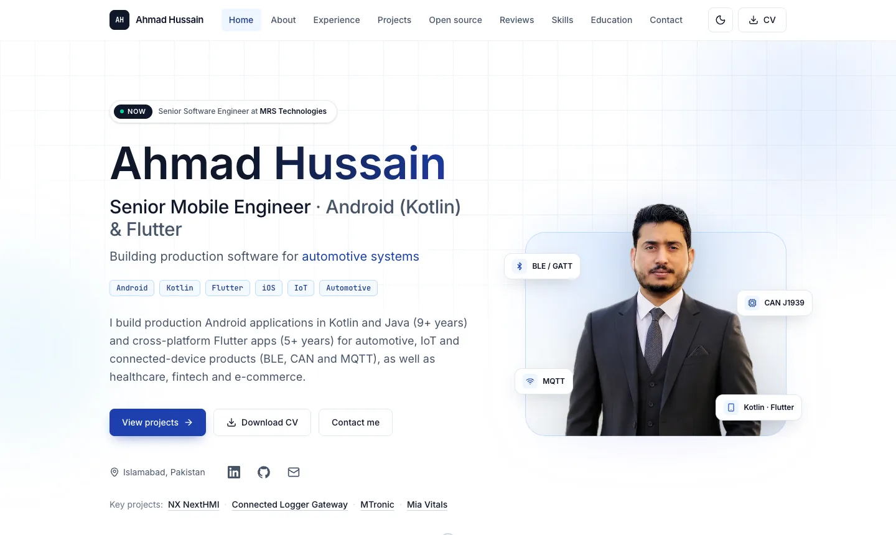
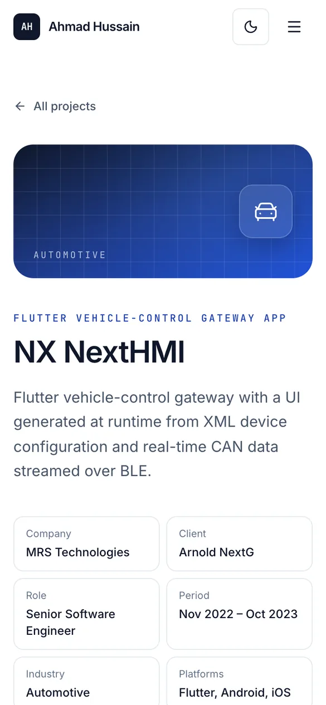

# ahmadhussain.dev

Source of **[ahmadhussain.dev](https://ahmadhussain.dev)**, the portfolio of Ahmad Hussain, a senior mobile engineer building Android (Kotlin, Java) and Flutter apps for automotive, IoT and connected-device products.

[](https://ahmadhussain.dev) [](https://github.com/Ahmadhussain0335/Ahmadhussain0335.github.io/actions/workflows/deploy-pages.yml)   

<p align="center">
  <picture>
    <source media="(prefers-color-scheme: dark)" srcset="docs/images/home-dark.webp">
    
  </picture>
  &nbsp;
  <picture>
    <source media="(prefers-color-scheme: dark)" srcset="docs/images/project-mobile-dark.webp">
    
  </picture>
</p>

## What is on the site

- **Profile and experience:** summary, career timeline and education.
- **Projects:** six case studies (NX NextHMI, Connected Logger Gateway, MTronic, Mia Vitals, Mafell ZAS, FoodRunner), each with screenshots, engineering notes and App Store, Google Play or website links.
- **Open source:** published Flutter and TypeScript packages on pub.dev and npm, with copyable install commands.
- **Reviews, skills and contact:** verbatim client reviews, grouped skills, a contact form and a downloadable CV.

## Features

- **Fully static.** `output: "export"` produces plain HTML, CSS and JS, with no server code.
- **Hosting.** GitHub Pages, deployed by GitHub Actions on every merge to `main`.
- **DNS.** Cloudflare DNS with DNSSEC; HTTPS is enforced.
- **SEO.**
  - Per-page titles, descriptions and canonical URLs.
  - JSON-LD (`Person`, `ProfilePage`, `CreativeWork`, `BreadcrumbList`).
  - A sitemap and robots.txt.
  - Share images generated at build time as real PNG files (`/og/*.png`).
- **Accessibility.**
  - Checked with axe in light and dark themes.
  - Keyboard-operable sliders and screenshot dialogs.
  - Tap targets of at least 44 px.
  - Visible focus.
  - Honours `prefers-reduced-motion`.
- **Responsive.** Tested from 320 px phones to 1440 px desktops; on phones, long sections collapse behind toggles.
- **Light and dark theme.** It follows the system setting, has a manual toggle and does not flash on load.
- **Privacy.** No cookies and no consent banner. Optional page-view statistics come from cookieless Cloudflare Web Analytics.
- **Performance.**
  - Pre-sized WebP images.
  - Scroll reveals in CSS (`animation-timeline`) instead of a JavaScript animation library.

## Tech stack

| Area | Choice |
| --- | --- |
| Framework | Next.js 16 (App Router, Turbopack), React 19 |
| Language | TypeScript (strict) |
| Styling | Tailwind CSS 4, CSS custom properties for themes |
| Icons | lucide-react, plus inline SVG brand icons |
| Share images | `next/og` (`ImageResponse`), rendered during the build |
| Hosting | GitHub Pages via GitHub Actions |
| DNS and TLS | Cloudflare (DNSSEC); Let's Encrypt certificate issued by GitHub |
| Analytics | Cloudflare Web Analytics (cookieless, optional) |

## Project structure

```
src/
  app/                  Routes: home, /projects/[slug], /og/[file] share images, sitemap, robots
  components/
    layout/             Navbar, footer, call-to-action band
    sections/           Home page sections (hero, experience, projects, open source, reviews...)
    ui/                 Reusable pieces: slider, screenshot gallery, theme toggle, copy button...
  content/              All text and data, typed (see below)
  lib/                  Metadata helpers, share-image renderer, JSON-LD
public/
  images/               Portrait and app screenshots
  resume/               Downloadable CV (PDF)
docs/                   SEO notes and README images
.github/workflows/      Build and deploy to GitHub Pages
```

## Editing content

Every fact on the site lives in a typed data file under `src/content/`. Components only render it.

| File | Contents |
| --- | --- |
| `site.ts` | Name, title, summary, contact links, CV path, languages, navigation |
| `experience.ts` | Employment timeline |
| `projects.ts` | Project cards and case-study pages (`/projects/[slug]`) |
| `earlier-projects.ts` | Smaller earlier projects shown in a compact slider |
| `open-source.ts` | Published packages and other repositories |
| `reviews.ts` | Client reviews |
| `skills.ts` | Skill groups |
| `education.ts` | Degrees and certifications |
| `engineering.ts` | "How I build" principles |

- **New project:** add an entry to `projects.ts` with a unique `slug`. The page, the sitemap entry and the share image are generated automatically.
- **Store links:** fill `links.appStore` or `links.playStore`; buttons render only when a URL is set.
- **CV:** replace `public/resume/Ahmad-Hussain-CV.pdf`.

## Local development

Requires Node.js 22 (see `.nvmrc`).

```bash
npm install
npm run dev                        # http://localhost:3000
npm run lint
npx next typegen && npx tsc --noEmit
npm run build                      # static site in out/
npx serve out                      # preview the export
```

Copy `.env.example` to `.env.local` to set the variables below locally.

## Deployment

`.github/workflows/deploy-pages.yml` runs lint, the type check and the build on every pull request. On every push to `main` it publishes `out/` to GitHub Pages.

The build reads these **repository variables** (Settings → Secrets and variables → Actions → Variables). They end up in the browser bundle, so they are variables, not secrets.

| Variable | Purpose |
| --- | --- |
| `NEXT_PUBLIC_SITE_URL` | Canonical URL for metadata, share images and the sitemap: `https://ahmadhussain.dev` |
| `NEXT_PUBLIC_CF_ANALYTICS_TOKEN` | Cloudflare Web Analytics token; without it no analytics script loads |
| `NEXT_PUBLIC_FORMSPREE_ID` | Optional Formspree form ID; without it the contact form opens a prefilled email |
| `NEXT_PUBLIC_GOOGLE_SITE_VERIFICATION` | Optional; not needed when Search Console is verified by DNS |

**Custom domain setup:**
- Repository Settings → Pages: source **GitHub Actions**, custom domain `ahmadhussain.dev`, **Enforce HTTPS** on. No `CNAME` file is needed with Actions deployments.
- Cloudflare DNS records, all DNS only:
  - four `A` records (`185.199.108–111.153`)
  - four `AAAA` records (`2606:50c0:8000–8003::153`)
  - a `www` CNAME to `ahmadhussain0335.github.io`
- The domain is verified on the GitHub account, which protects it against takeover.
- Do not set `basePath`: the custom domain serves from the root.

More detail on search setup: [`docs/SEO.md`](docs/SEO.md).

## License

No open-source license applies to this repository. The code is public for reference. The content (text, portrait, CV, reviews and app screenshots) belongs to Ahmad Hussain or to the respective app owners, and all rights are reserved. For reuse, please get in touch.

## Contact

[ahmadhussain.dev](https://ahmadhussain.dev) · [LinkedIn](https://www.linkedin.com/in/ahmad-hussain-b3268a15a/) · [ahmadhussain0335@gmail.com](mailto:ahmadhussain0335@gmail.com)
